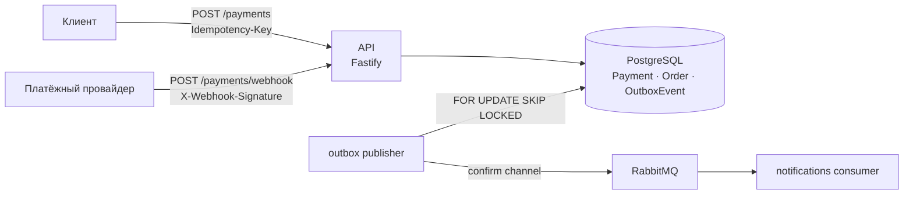

# OrderHub

[](https://github.com/akoody/orderhub/actions/workflows/ci.yml)

Сервис заказов и платежей, который остаётся корректным при сбоях и повторах: идемпотентное создание платежей, подписанные вебхуки провайдера, transactional outbox с доставкой «хотя бы один раз» и оптимистичная блокировка при смене статуса заказа.

**Стек:** TypeScript (strict), Fastify 5, PostgreSQL 16 + Prisma 7, RabbitMQ, Redis, Prometheus, Vitest.

## Как устроено



1. **Создание платежа** идёт с заголовком `Idempotency-Key`. Повтор того же запроса возвращает тот же платёж; тот же ключ для другого заказа или от другого пользователя даёт `422` и не раскрывает чужой платёж ([RFC-0001](docs/RFC-0001-Idempotency.md)).
2. **Вебхук провайдера** принимается только с подписью `sha256=HMAC(raw body)`. Переход `PENDING → SUCCESS`, перевод заказа в `PAID` и запись события в outbox выполняются в одной транзакции; повтор вебхука ничего не меняет.
3. **Outbox publisher** забирает события через `FOR UPDATE SKIP LOCKED` (несколько экземпляров не дублируют работу), публикует через confirm-канал и помечает `SENT` только после ack брокера. Ошибки повторяются с экспоненциальной задержкой, после 10 попыток событие получает статус `ERROR`.
4. **Смена статуса заказа** доступна только роли `ADMIN` и требует `x-order-version`: при устаревшей версии ответ `409`.

Слои: `app/routes` (HTTP и валидация на zod), `modules/*/usecases` (бизнес-правила без зависимости от Fastify) и `shared` (Prisma, RabbitMQ, Redis, метрики, конфиг). Подробнее: [docs/ARCHITECTURE.md](docs/ARCHITECTURE.md).

## Безопасность

- Access-токен (15 минут) содержит роль; refresh-токен хранится в БД как SHA-256, лежит в httpOnly-cookie и гасится одним условным `UPDATE`, поэтому повторно его не использовать.
- Секреты (`JWT_SECRET`, `PAYMENT_WEBHOOK_SECRET`) проверяются при старте, минимум 32 символа; значений по умолчанию нет.
- Мок-провайдер `/provider/mock/pay` регистрируется только при `MOCK_PROVIDER_ENABLED=true`.
- Rate limit на вход: 5 попыток в минуту.

## Запуск

```bash
cp .env.example .env            # задать JWT_SECRET и PAYMENT_WEBHOOK_SECRET: openssl rand -hex 32
docker compose up -d            # PostgreSQL, Redis, RabbitMQ
pnpm install
pnpm db:migrate
pnpm dev                        # API на :3000
pnpm worker:outbox
pnpm worker:notifications
pnpm admin:grant you@example.com   # выдать роль ADMIN
```

Сквозной сценарий с мок-провайдером:

```bash
TOKEN=$(curl -s localhost:3000/auth/register -H 'content-type: application/json' \
  -d '{"email":"me@example.com","password":"password123"}' | jq -r .accessToken)
ORDER=$(curl -s localhost:3000/orders -H "authorization: Bearer $TOKEN" -H 'content-type: application/json' \
  -d '{"items":[{"price":100,"quantity":2}]}' | jq -r .orderId)
PAYMENT=$(curl -s localhost:3000/payments -H "authorization: Bearer $TOKEN" -H "Idempotency-Key: $(uuidgen)" \
  -H 'content-type: application/json' -d "{\"orderId\":\"$ORDER\"}" | jq -r .paymentId)
curl -s localhost:3000/provider/mock/pay -H 'content-type: application/json' -d "{\"paymentId\":\"$PAYMENT\"}"
```

## API

| Метод | Путь | Доступ |
|---|---|---|
| `POST` | `/auth/register`, `/auth/login`, `/auth/refresh`, `/auth/logout` | публичный |
| `GET` | `/me` | пользователь |
| `POST` | `/orders` | пользователь |
| `GET` | `/orders/me` | пользователь |
| `PATCH` | `/admin/orders/:id/status` | `ADMIN`, заголовок `x-order-version` |
| `POST` | `/payments` | пользователь, заголовок `Idempotency-Key` |
| `POST` | `/payments/webhook` | провайдер, заголовок `X-Webhook-Signature` |
| `POST` | `/provider/mock/pay` | только при `MOCK_PROVIDER_ENABLED=true` |
| `GET` | `/health`, `/ready`, `/metrics` | эксплуатация |

Метрики Prometheus: `http_request_duration_seconds`, `http_requests_total`, `queue_processed_total`, `outbox_lag`. Что делать при росте очереди или повторах вебхуков: [docs/RUNBOOK.md](docs/RUNBOOK.md).

## Тесты и CI

```bash
pnpm format:check && pnpm lint && pnpm typecheck
pnpm test        # нужен PostgreSQL из DATABASE_URL с применёнными миграциями
```

Тесты идут против настоящего PostgreSQL: подписи вебхуков, идемпотентность (повтор, чужой ключ, другой заказ), права админа и оптимистичная блокировка, одноразовость refresh-токена при параллельных запросах, доставка outbox с повторами и параллельными публикаторами. CI ([ci.yml](.github/workflows/ci.yml)) прогоняет форматирование, линтер, типы, миграции, тесты и сборку на каждом PR.

Нагрузочный сценарий: `pnpm perf:k6` ([scripts/k6/orderhub.js](scripts/k6/orderhub.js)).

## Ограничения

- Сообщение, которое потребитель не смог обработать, отклоняется без повторной постановки в очередь и теряется: нужна dead-letter очередь.
- Роль в access-токене обновляется только при выдаче нового токена: снятие роли действует в течение 15 минут.
- Суммы хранятся целыми числами в минимальных единицах валюты; валюта одна и в модели не хранится.

## Лицензия

[MIT](LICENSE)
